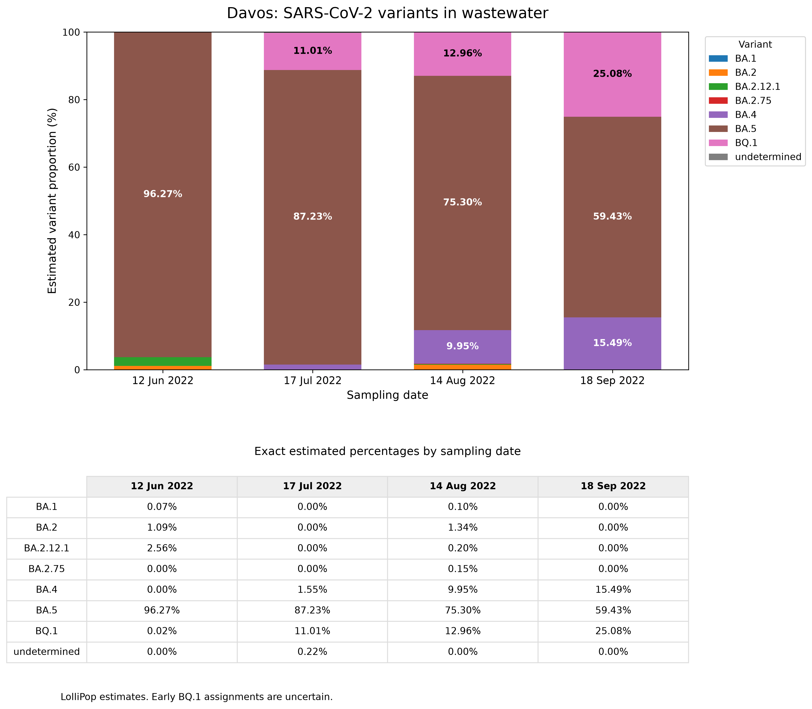
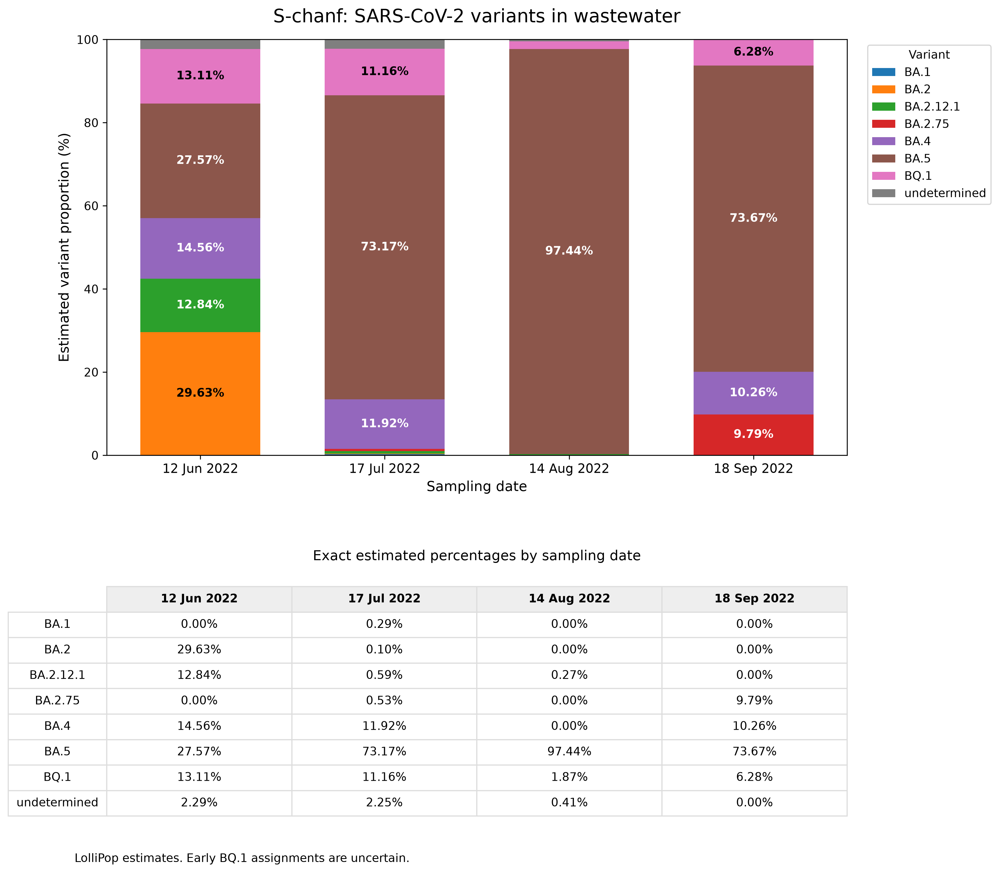
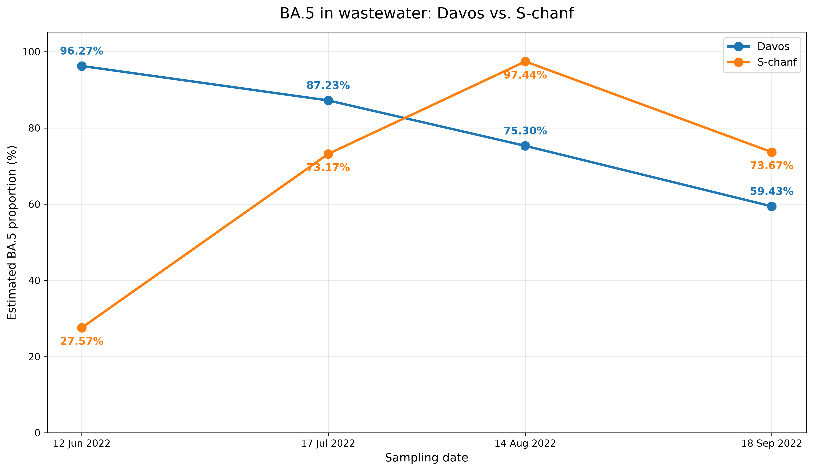

# SARS-CoV-2-Varianten im Abwasser – Davos und S-chanf (2022)


Dieses Repository dokumentiert die bioinformatische Analyse von SARS-CoV-2-RNA-Sequenzierdaten aus Abwasserproben von Davos und S-chanf. Ziel war es, die relativen Anteile ausgewählter Virusvarianten zu schätzen, die zeitliche Entwicklung zwischen Juni und September 2022 darzustellen und die Ergebnisse biologisch einzuordnen.

Der wissenschaftliche Bericht ist unter [Aufgabe 5 Abgabebericht.pdf](Aufgabe%205%20Abgabebericht.pdf) zu finden.

## 1. Datengrundlage

- Standorte: Davos und S-chanf (Graubünden, Schweiz)
- Probenahmetermine: 12.06.2022, 17.07.2022, 14.08.2022 und 18.09.2022
- Datensatz: 8 Abwasserproben mit jeweils zwei zugehörigen FASTQ-Dateien (R1 und R2), insgesamt 16 komprimierte FASTQ-Dateien
- Überprüfte Read-Länge: 151 Nukleotide
- Originaldaten: [SWITCHdrive – Kursdatensatz](https://drive.switch.ch/index.php/s/QkQFHyJViDoHC9t)

Wichtig: Die grossen Original-FASTQ-Dateien sind nicht Bestandteil dieses Repositories. Sie wurden vom Kurs bereitgestellt und werden hier nicht erneut öffentlich veröffentlicht. Für die vollständige Reproduktion müssen die Rohdaten separat bezogen und in die von V-pipe erwartete Probenstruktur eingebunden werden.

## 2. Verwendete Methoden

1. V-pipe / Snakemake: Verarbeitung der paired-end Sequenzierungsreads und Vorbereitung der SARS-CoV-2-Mutationsanalyse.
2. COJAC: Analyse gemeinsam auftretender variantenassoziierter Mutationen anhand der VOC-Signaturen.
3. tallymut: Zusammenstellung der Mutationsinformationen nach Probe, Standort und Datum.
4. LolliPop: Deconvolution der Mutationssignale zur Schätzung relativer Variantenanteile und zugehöriger Intervallgrenzen.
5. Python (pandas, matplotlib): Qualitätskontrolle, tabellarische Auswertung und Visualisierung.

Die VOC-Signaturen wurden mithilfe von COJAC/CovSpectrum für folgende sieben untersuchte Pangolin-Gruppen erstellt: BA.1, BA.2, BA.2.12.1, BA.2.75, BA.4, BA.5 und BQ.1. In der Ergebnisausgabe erscheint zusätzlich die Kategorie `undetermined`.

Die Variantenauswahl orientierte sich an CoVariants, Schweiz, Region 6, Pangolin-Darstellung, Mai–Oktober 2022. Ob das verwendete Set alle damals dort aufgeführten Gruppen vollständig abdeckt, wurde nicht abschliessend verifiziert. Alle Ergebnisse beziehen sich daher ausdrücklich auf das dokumentierte Variantenset.

## 3. Repository-Struktur

.
├── README.md
├── Aufgabe 5 Abgabebericht.pdf
├── config.yaml
├── samples.tsv
├── timeline.tsv
├── deconv_linear_logit_quasi_strat.yaml
├── vocs/                              # Sieben VOC-Mutationsdefinitionen (YAML)
├── results/
│   ├── cohort_cooc.v41.csv           # COJAC: Mutations-Kookkurrenz
│   ├── cohort_cooc_report.v41.csv    # COJAC: Zusammenfassender Bericht
│   ├── tallymut.tsv.zst              # Mutationsdaten für LolliPop
│   ├── deconvoluted.tsv.zst          # LolliPop: geschätzte Variantenanteile
│   └── deconvoluted.tsv              # Optional: entpackte Ergebnistabelle
└── plots/
    ├── davos_variants_labeled.png
    ├── schanf_variants_labeled.png
    └── ba5_comparison_labeled.png
```

Die Ordner enthalten die Dateien, soweit sie in den Abgabeordner übernommen wurden. Installationsdateien, Conda-Umgebungen, `.snakemake/` und die Original-FASTQ-Dateien gehören nicht in dieses Repository.

## 4. Analyse und Reproduzierbarkeit

Die Analyse wurde unter Ubuntu (WSL2 auf Windows) mit V-pipe, Snakemake und Conda ausgeführt. Die folgenden Befehle wurden im ursprünglichen V-pipe-Projektverzeichnis `wastewater/` verwendet. Sie können nicht allein im Abgabe-Repository ohne V-pipe-Installation, Rohdaten und korrekte Probenverzeichnisse ausgeführt werden.

COJAC:

```bash
./vpipe --cores 2 --conda-frontend conda allCooc samples/cohort_cooc_report.v41.csv --resources mem_mb=9000
```

LolliPop:

```bash
./vpipe --cores 2 --conda-frontend conda deconvolution --resources mem_mb=9000
```

Die COJAC-Analyse wurde mit 77 von 77 Jobs erfolgreich abgeschlossen. Nach Abschluss der vorbereitenden Arbeitsschritte wurde auch der finale LolliPop-Job erfolgreich ausgeführt.

Technischer Hinweis: In der verwendeten LolliPop-Conda-Umgebung mit `pandas 3.1.1` führte ein veralteter Aufruf von `DataFrame.applymap()` zu einem Fehler. Die betroffene Stelle in `lollipop/cli/deconvolute.py` wurde nach Erstellung einer Sicherungskopie von `.applymap(` auf `.map(` geändert. Danach lief der letzte Job erfolgreich. Dieser lokale Kompatibilitätseingriff ist für eine exakte Reproduktion mit denselben Versionen zu berücksichtigen.

Primerprotokoll: Für `samples.tsv` und `timeline.tsv` wurde `v41` (ARTIC V4.1) verwendet, gestützt auf die Literatur zu Abwasserproben aus dem entsprechenden Zeitraum. Die exakte Übereinstimmung mit den hier bereitgestellten 151-nt-Reads konnte mangels unabhängiger Probenmetadaten nicht bestätigt werden.

## 5. Ergebnisse

Die LolliPop-Ausgabe enthält 64 Ergebniszeilen für acht Standort-Termin-Kombinationen und acht Varianten/Kategorien mit den Spalten `location`, `variant`, `date`, `proportion`, `proportionLower`, `proportionUpper`. Die ungerundeten geschätzten Anteile summieren sich pro Probe auf 100 %; in der Ergebnistabelle wurden keine fehlenden Werte festgestellt.

Geschätzte BA.5-Anteile:

| Probenahmedatum | Davos | S-chanf |
|---|---:|---:|
| 12.06.2022 | 96,27 % | 27,57 % |
| 17.07.2022 | 87,23 % | 73,17 % |
| 14.08.2022 | 75,30 % | 97,44 % |
| 18.09.2022 | 59,43 % | 73,67 % |

BA.5 war in Davos an allen vier Terminen die am höchsten geschätzte Variante. In S-chanf war am 12.06.2022 BA.2 mit 29,63 % die grösste geschätzte Gruppe; ab Juli dominierte BA.5.

### Diagramme

Davos – geschätzte Variantenanteile



S-chanf – geschätzte Variantenanteile



BA.5 – Vergleich zwischen Davos und S-chanf



## 6. Wissenschaftliche Einordnung und Einschränkungen

- Auffällige BQ.1-Schätzungen: LolliPop schätzte teilweise hohe BQ.1-Anteile bereits im Juni und Juli 2022. Die frühen Zuordnungen sind mit dem bekannten zeitlichen Auftreten der Linie schwer vereinbar und dürfen nicht als gesicherter Nachweis interpretiert werden.
- Mutationskontrolle: Die für BQ.1 relevante Position 22893 (Spike K444T) zeigte beispielsweise am 17.07.2022 in Davos 0 von 103 alternativen Reads und am 12.06.2022 in S-chanf 0 von 58. Die Position 22942 (Spike N460K) war in diesen Proben nicht abgedeckt. An einer Position ohne Abdeckung lässt sich die Anwesenheit oder Abwesenheit einer Mutation nicht bestimmen.
- Modellabhängigkeit: Die Variantenanteile hängen von den verwendeten Mutationssignaturen, dem Variantenset und der Sequenzierungsabdeckung ab. Auch berechnete Konfidenzintervalle beseitigen mögliche Fehler bei der Variantenzuordnung nicht.
- Geringe zeitliche Auflösung: Pro Standort liegen nur vier Probenahmetermine vor. Linien zwischen Messpunkten sind Visualisierungen, keine zusätzlichen Messungen.
- Relative Anteile: Die Prozentzahlen beschreiben modellierte Anteile viraler Varianten im Abwasser, nicht die Prävalenz infizierter Personen oder absolute Fallzahlen.

Die Ergebnisse sind deshalb als modellbasierte Schätzungen und unter Beachtung dieser Limitationen zu interpretieren.

## 7. Literatur und Dokumentation

1. [V-pipe: SARS-CoV-2 Wastewater Surveillance Tutorial](https://gsod-vpipe.readthedocs.io/en/latest/tutorials/tutorial_cowwid.html)
2. Jahn, K. et al. (2022). *Early detection and surveillance of SARS-CoV-2 genomic variants in wastewater using COJAC*. Nature Microbiology, 7, 1151–1160. [DOI](https://doi.org/10.1038/s41564-022-01185-x)
3. Zhakparov, D. et al. (2023). *Sequencing of SARS-CoV-2 RNA Fragments in Wastewater Detects the Spread of New Variants during Major Events*. Microorganisms, 11, 2660. [DOI](https://doi.org/10.3390/microorganisms11112660)
4. [CoVariants](https://covariants.org/) – Variantenauswahl: Schweiz, Region 6, Pangolin, Mai–Oktober 2022.
5. [CovSpectrum](https://cov-spectrum.org/) / [LAPIS](https://lapis.cov-spectrum.org/open/v2) – Mutationssignaturen.
6. [SWITCHdrive: Kursdatensatz](https://drive.switch.ch/index.php/s/QkQFHyJViDoHC9t).

---

*Dieses Repository dient der Dokumentation einer biologischen Projektarbeit. Die hier dargestellten Variantenanteile sind Ergebnisse einer bioinformatischen Modellierung und keine klinische Diagnostik.*
